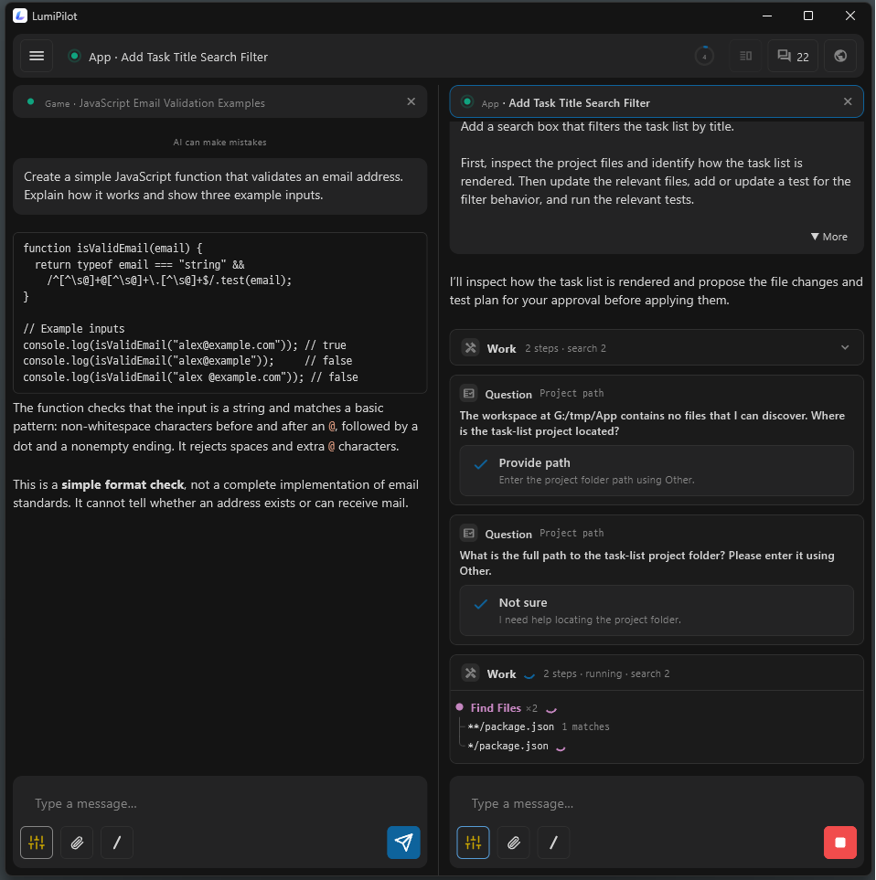
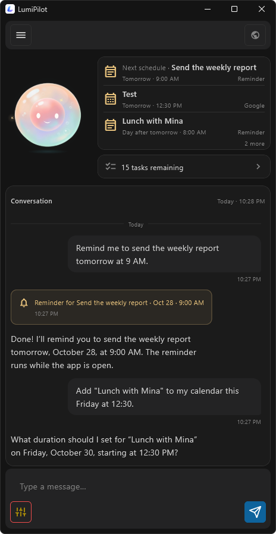
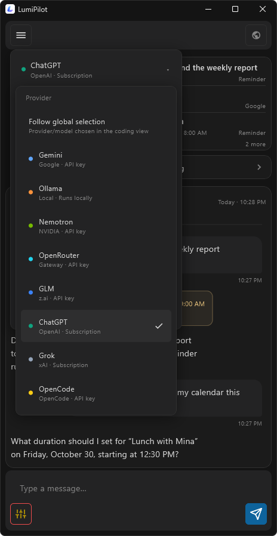
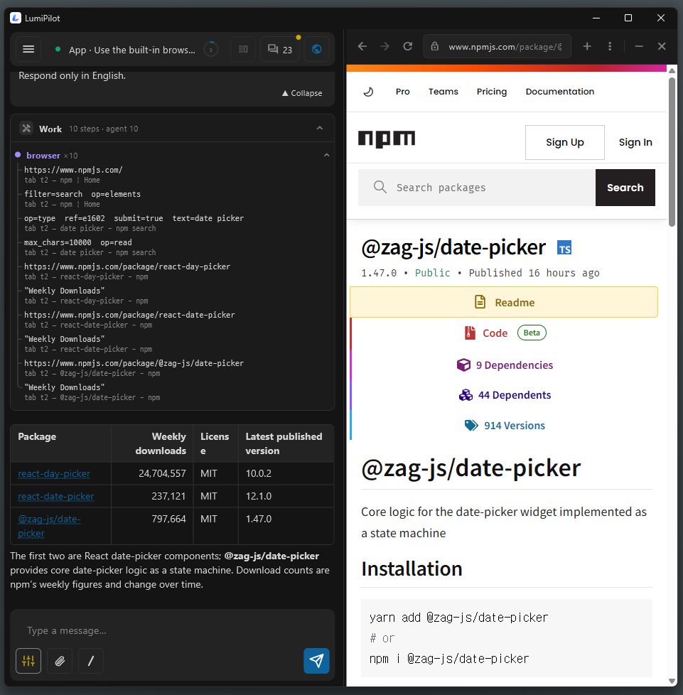

<p align="center">
  
</p>

# LumiPilot

**English** | [한국어](README.ko.md)

LumiPilot is a Windows desktop AI assistant for coding and everyday tasks. Choose an AI provider and a working folder to read and edit files, run commands, and explore the web. You control when tools need approval.

> This repository distributes the Windows app. The app's source code is not published here.

## Screenshots

### Coding sessions

Work on multiple conversations side by side, inspect tool activity, and approve commands before they run.

<p align="center">
  
</p>

### Lumi and AI providers

Ask Lumi about reminders and your calendar, and choose the AI provider for a character session.

<p align="center">
  
  
</p>

### Built-in browser

Browse pages alongside a conversation and ask the assistant to work with web content.

<p align="center">
  
</p>

## Download

Get the latest installer or portable ZIP from **[Releases](https://github.com/lumipilot/LumiPilot/releases/latest)**.

1. Download one of these and the `.sha256` file with the same name:
   - Installer: `LumiPilot-<version>-build<N>-windows-x64-setup.exe`
   - Portable ZIP: `LumiPilot-<version>-build<N>-windows-x64.zip`
2. Open PowerShell in the download folder. Replace the example name with the filename you downloaded, then compare the two hashes:
   ```powershell
   $File = 'LumiPilot-1.0.23-build123-windows-x64-setup.exe'
   (Get-FileHash -LiteralPath $File -Algorithm SHA256).Hash
   Get-Content -LiteralPath "$File.sha256"
   ```
   The SHA-256 hashes must match. `build123` is an example, not the release's actual build number.
3. Run the installer, or extract the ZIP anywhere and run `LumiPilot.exe`.

The installer needs no administrator rights. It installs for the current user only, adds a Start menu entry, and can be removed from Windows Settings → Apps. Removing it does not delete your data and settings (`%APPDATA%\LumiPilot`).

Requirements: Windows 10/11 (64-bit) and the Microsoft Edge WebView2 Runtime for browser features.

If the release is not code-signed, Windows SmartScreen may show a warning on first run. The checksum checks download integrity; it does not verify the publisher.

Optional — live Visual Studio debugging: close Visual Studio, run `extras\LumiPilotDebugBridge.vsix` from the extracted folder (Visual Studio 2022 or 2026), then restart Visual Studio. The extension is not signed, so the VSIX installer may warn about it. Crash-dump analysis works without it.

## User guide

New to LumiPilot? Read the **[User Guide](docs/user-guide.md)** for setup, conversations, approvals, settings, and troubleshooting.

## What it does

- **Coding agent** — reads, searches and edits files in a working folder, runs shell commands, works with Git, and shows file changes as diffs.
- **Many AI providers** — Anthropic, OpenAI, Google Gemini, xAI, NVIDIA, Z.ai, OpenRouter, OpenCode, Ollama (local), and any OpenAI-compatible endpoint you add yourself. Some providers also support signing in with a subscription account; whether that is allowed is up to each provider's terms.
- **Permission control** — Normal, AcceptEdits and Bypass modes, plus per-tool allow/ask/deny rules and a plan-then-approve flow.
- **Checkpoints** — restore files the app edited to an earlier turn. Checkpoints are not a replacement for your own backups.
- **Subagents, skills, plugins and MCP** — delegate work to subagents, extend the app with skills and plugins, and connect MCP servers.
- **Built-in browser** — web pages, HTML preview and web automation inside the app. Sign-ins stay in the app's own browser profile.
- **Integrations** — Gmail / Google Calendar / Drive (with your own Google OAuth client), IMAP/SMTP mail, scheduled tasks.
- **Voice and images** — voice input and spoken replies, and image generation through providers you configure.
- **Lumi** — the app's character, who keeps you company next to your work.

## Important notes

- **Not a sandbox.** Approved commands and tools run with your user account's permissions. Do not run the app as administrator, and try risky tasks on a copy first.
- **Your data goes where you send it.** Conversations, files and tool results are sent to the AI provider and integrations you choose. The app does not send usage statistics, conversations or crash data to the developer and does not check for updates.
- **Costs.** The app is free; external AI subscriptions and APIs may cost money.
- **AI can be wrong.** Review changes before relying on them.

Data location: `%APPDATA%\LumiPilot\LumiPilot`

## Legal

| Document | English | 한국어 |
|----------|---------|--------|
| Free binary license | [license](legal/en/license.txt) | [라이선스](legal/ko/license.txt) |
| Usage and safety notice | [usage](legal/en/usage.txt) | [사용·안전 안내](legal/ko/usage.txt) |
| Data handling notice | [data](legal/en/data.txt) | [데이터 처리 안내](legal/ko/data.txt) |

The same notices are shown inside the app on first run.

## Community

Join the [official LumiPilot Discord community](https://discord.gg/e3j5EnK3J) for questions, public bug reports and feature requests. Korean and English are both welcome.

For private or security-sensitive matters, use email rather than Discord.

## Support

Questions and problem reports: **lumipilothelp@gmail.com**

Please include the version, time, permission mode, symptoms and steps to reproduce. Do not send API keys, passwords, full conversations or whole repositories. No response deadline is promised.
